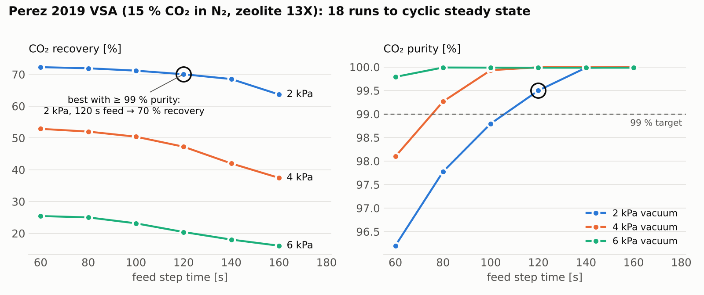
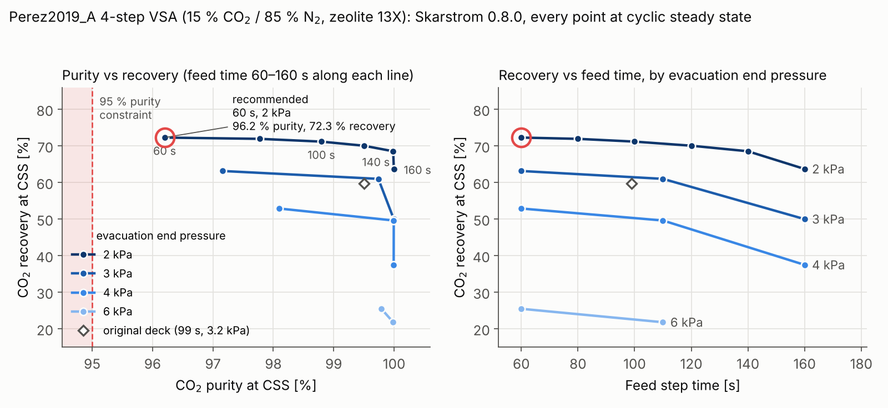

<p align="center">
  <picture>
    <source media="(prefers-color-scheme: dark)" srcset="docs/assets/logo-dark.png">
    
  </picture>
</p>

# Skarstrom

[](https://github.com/samaffleck/skarstrom/actions/workflows/ci.yml)
[](https://samaffleck.github.io/skarstrom/)
[](LICENSE)

**Skarstrom** is an open-source library for adsorption process simulations including **pressure, vacuum and temperature swing adsorption** (PSA, VSA and TSA). Written in C++, the engine solves a 1D finite-volume model of a packed-bed adsorption column with multiple layers. Skarstrom is designed for engineers and scientists to rapidly develop new adsorption-based gas separation systems, with modules for accelerating convergence to cyclic steady state and for optimising purity, recovery, productivity and energy consumption.

## Quick start: optimise a VSA cycle from the command line

This example takes one of the 43 bundled [examples](https://samaffleck.github.io/skarstrom/examples/), [`Perez2019_A`](https://github.com/samaffleck/skarstrom/blob/main/examples/decks/Perez2019_A.json). It is a 4-step vacuum swing adsorption (VSA) cycle that captures CO₂ from a 15 % CO₂ / 85 % N₂ flue gas on zeolite 13X. You can find the feed time and vacuum level that give the most CO₂ for a purity target.

**1. Install** (wheels for CPython 3.10–3.15 on Linux, macOS and Windows):

```bash
pip install skarstrom matplotlib
```

**2. Run the example to cyclic steady state:**

```console
$ skarstrom examples run Perez2019_A
Deck:    Perez2019_A
Status:  reached_css (cyclic steady state reached at cycle 49)
Cycles:  49 run in 40.00 s (160801 integrator steps)
CSS:     reached at cycle 49

KPIs at cycle 49:
component      purity [mol/mol]  recovery [mol/mol]  productivity [kg/(kg s)]  ...
CarbonDioxide  0.995067          0.596507            3.6742e-05                ...

Warning: the approach to fluidisation reaches 1.17 in step "Pressurisation" of cycle 49 (...)
```

The deck as shipped uses a fine, grid-converged mesh (80 cells), so one run takes about 40 s; the [Performance](#performance) table below uses 30 cells. The warning is an operating limit, not a numerical problem: the fast repressurisation would lift an unrestrained bed. The KPIs are still valid, because the model holds the bed fixed.

**3. Find the design variables, then sweep them.** Every value in a deck has a stable path, and `skarstrom params` lists them:

```console
$ skarstrom params Perez2019_A --search Evacuation      # columns trimmed
path                                          value             unit  alias
step[3].time                                  57                s     step[Evacuation].time
endpoint[4].pressure_double_exponential_end   3.2e+03 (= 3200)  Pa    step[Evacuation].bottom.pressure_double_exponential_end
...
```

`--set` changes any value on the command line (units are checked), and `--json` writes a machine-readable summary. This loop runs 18 cases (6 feed times × 3 vacuum levels), three at a time. The vacuum level is the end pressure of the evacuation step's exponential pressure curve:

```bash
for vac in 2 4 6; do
  for feed in 60 80 100 120 140 160; do
    skarstrom examples run Perez2019_A -q --json \
      --set "step[Feed].time=$feed" \
      --set "step[Evacuation].bottom.pressure_double_exponential_end=$vac [kPa]" \
      > run_${vac}kPa_${feed}s.json
  done &
done
wait
```

**4. Plot the results.** Each JSON file holds the KPIs of every cycle; the last entry is the converged cycle:

```python
import glob, json, re
import matplotlib.pyplot as plt

runs = {}
for f in glob.glob("run_*.json"):
    vac, feed = map(int, re.findall(r"\d+", f))
    co2 = json.load(open(f))["kpis"][-1]          # CO2 KPIs of the last cycle
    runs.setdefault(vac, []).append((feed, co2["recovery"], co2["purity"]))

fig, (left, right) = plt.subplots(1, 2, figsize=(10, 4), sharex=True)
for vac, points in sorted(runs.items()):
    feed, recovery, purity = zip(*sorted(points))
    left.plot(feed, recovery, "o-", label=f"{vac} kPa")
    right.plot(feed, purity, "o-")
left.set(xlabel="feed time [s]", ylabel="CO2 recovery")
right.set(xlabel="feed time [s]", ylabel="CO2 purity")
left.legend(title="vacuum")
fig.tight_layout()
fig.savefig("sweep.png", dpi=150)
```

<p align="center">
  <picture>
    <source media="(prefers-color-scheme: dark)" srcset="docs/assets/readme-sweep-dark.png">
    
  </picture>
</p>

A deeper vacuum is the strongest lever on recovery. The feed time trades purity against recovery. For a 99 % purity target, the best of these 18 runs is a 2 kPa vacuum with a 120 s feed: 99.5 % purity at 70 % recovery. That is 10 points more recovery than the deck as shipped (99 s, 3.2 kPa: 99.5 % purity, 59.7 % recovery). All 18 runs reached cyclic steady state, and the sweep took about 5 minutes on 4 cores. The fluidisation warning above appears at 4 kPa and below. (The figure is a styled version of the plot above, drawn by [`scripts/docs/readme_figures.py`](scripts/docs/readme_figures.py).)

**5. Or let the optimiser search.** *New in 0.9.* `skarstrom.optimisation` searches the same two variables with a global optimiser (dlib's MaxLIPO with a trust region). It starts each candidate from the converged state of the nearest earlier candidate, so most runs need far fewer cycles:

```python
import skarstrom
from skarstrom import ureg as u
from skarstrom import optimisation as opt

sim = skarstrom.examples.Perez2019_A.load()
result = opt.optimise(
    sim,
    {"step[Feed].time": (60 * u.s, 160 * u.s),
     "step[Evacuation].bottom.pressure_double_exponential_end": (2 * u.kPa, 6 * u.kPa)},
    objectives=[opt.maximise("CarbonDioxide", "recovery")],
    constraints=[opt.at_least("CarbonDioxide", "purity", 0.95, penalty=10)],
    evaluations=20,
)
print(result.x)                       # feed 60 s, evacuation 2000 Pa
print(result.kpis["CarbonDioxide"])   # purity 0.964, recovery 0.726
```

The 20 candidates took about 10 minutes on one core. The warm-started candidates needed 33 cycles on average, against 73 for the cold re-run of the optimum. With a 95 % purity target, the best point is on the corner of the search box (the shortest feed and the deepest vacuum), so the next step is to widen the bounds.

## Use Skarstrom with AI agents

Skarstrom is built to be driven by AI coding agents (Claude Code, Codex, Cursor, Copilot and others) as well as by people:

- **[`AGENTS.md`](AGENTS.md)** tells an agent how to use the package: check the version, run a few cycles first, and treat a run-health warning as a wrong answer until it can explain it.
- **[`llms.txt`](https://samaffleck.github.io/skarstrom/llms.txt)** and **[`llms-full.txt`](https://samaffleck.github.io/skarstrom/llms-full.txt)** give the whole documentation as plain Markdown, for the latest release (and under [`/dev/`](https://samaffleck.github.io/skarstrom/dev/llms.txt) for `main`).
- **Machine-readable output.** `--json` on `run`, `examples`, `params` and `sensitivity`, with exit codes 0 (done), 1 (failed) and 130 (interrupted).
- **A parameter registry.** Every value has a stable path, a unit and bounds, so an agent changes `step[Feed].time` instead of editing deck JSON. Unknown paths and wrong units are errors, not silent typos.
- **Run-health checks** (*new in 0.9*). Each run reports structured warnings (`MOLE_FRACTION_SUM`, `MASS_BALANCE_STUCK`, `STEP_RETRIES`, `HISTORY_TRUNCATED`) with a value, a threshold and a hint, so an agent can tell a converged answer from a numerical artefact.
- **Documentation that runs.** CI executes every code block in the docs and in `AGENTS.md` against the built package, so the calls an agent reads are calls the engine accepts.

### Starter prompt

Copy this into any agent that can run shell commands, and replace the task at the end with your own:

```text
I want to use Skarstrom, an open-source simulator for pressure, vacuum and temperature swing adsorption (PSA/VSA/TSA), to answer a process design question.

Set-up:
- Install it with `pip install skarstrom matplotlib` (skip if already installed) and run `skarstrom --version`.
- Read the agent guide at https://github.com/samaffleck/skarstrom/blob/main/AGENTS.md and the docs index at https://samaffleck.github.io/skarstrom/llms.txt. Use the docs that match the installed version.

How to work:
- Use the `skarstrom` CLI with `--json -q`, or the Python API. Find parameter paths with `skarstrom params <deck> --search <text>`. Do not edit deck JSON by hand.
- Check a set-up with a short run (`--cycles 3`) before you run to cyclic steady state (CSS).
- After every run, check `status` and `warnings`. Do not trust a number until you can explain any warning.
- Give units, and say which numbers come from the simulation and which are your assumptions.

Task: Start from the bundled example `Perez2019_A` (a 4-step VSA that captures CO₂ from 15 % CO₂ / 85 % N₂ on zeolite 13X). Find the feed step time (60–160 s) and evacuation pressure (2–6 kPa) that give the highest CO₂ recovery with at least 95 % CO₂ purity at CSS. Plot the trade-off, mark your recommended point, and summarise the result in a short table.
```

### Example: Claude Code with the starter prompt

We gave the prompt above, unchanged, to a fresh Claude agent in [Claude Code](https://claude.com/claude-code). The agent had the Skarstrom 0.8.0 wheel and nothing else, and it worked without help. In about 12 minutes it did these things (condensed from its log):

1. It ran `skarstrom --version`, fetched `AGENTS.md` and `llms.txt`, and checked that the docs site root matches the installed release. It also noted that the run-health fields in `AGENTS.md` on `main` are not in 0.8.0 yet.
2. It found the two variables with `skarstrom params Perez2019_A --search ...` and checked a corner of the box with `--cycles 3` before it ran anything to CSS.
3. It ran 15 points to CSS with `skarstrom run ... --json -q` (three in parallel) and summarised them into a CSV.
4. It checked the recommended point with the Python API. Double the grid and tighter CSS tolerances both moved purity and recovery by less than 0.02 points.
5. It plotted the result:

<p align="center">
  
</p>

Its answer, shortened:

> **Recommended operating point: a 60 s feed with a 2 kPa evacuation end pressure.** At CSS this gives **72.3 % CO₂ recovery at 96.2 % purity**. The deck as shipped (99 s, 3.2 kPa) gives 59.7 % at 99.5 %.
>
> - Evacuation pressure is the strongest lever: each kPa lower adds about 10 points of recovery.
> - The 95 % purity limit is never reached in your ranges, so the optimum sits on two range limits. Below 2 kPa or 60 s is likely better, but I did not test outside your ranges.
> - 80 s / 2 kPa is a more robust choice: 71.9 % recovery with more purity margin (97.8 %) and 13 % higher productivity.
> - **Warnings:** the approach to fluidisation reaches 1.29 during pressurisation. This is an operating limit, not a numerical problem, so the KPIs stand, but the column needs a hold-down or a slower repressurisation. "2 kPa" is the end value of the vacuum curve: the bed itself reaches 2.9 kPa.
> - **Assumptions:** the other step times stay as in the deck. The deck has no vacuum pump model, so the energy reads 0. Check the pump work before you commit to 2 kPa.

The agent's grid search and the optimiser in step 5 of the quick start find the same corner: about 60 s and 2 kPa, at 72–73 % recovery.

## Graphical user interface

We host a user interface on the [Skarstrom website](https://www.skarstrom.co.uk/). It is a browser-based interface that runs the C++ engine and is the best starting point for users who don't want to write code. From the interface you can run examples, visualise the results, and run optimisation and parameterisation studies.

[](https://www.skarstrom.co.uk/)

## Why Skarstrom

Several commercial simulation packages are available, but to date there has been no good open-source tool for adsorption modelling. It has become common practice for people to write their own models from scratch, resulting in a lot of repeated work and a lack of transparency and reproducibility.

Skarstrom aims to bridge this gap by being the first comprehensive open project for adsorption researchers to collaborate on. We also showcase exceptional solver speed and performance, and hope this can be improved further by collaboration with the community.

## Performance

Cycle optimisation and parameter fitting are important design tasks that require running to cyclic steady state (CSS) hundreds or thousands of times, so Skarstrom has been optimised for performance to make these tasks practical on common hardware. There are no well-established performance benchmarks; however, the table below can be used as a guide to the expected time to reach CSS. You are encouraged to run the examples yourself and benchmark them against your own code.

| Example | Cells | Cycles to CSS | Time to CSS |
|---|---|---|---|
| [Basic 4-step VSA, 15 % CO₂ / N₂ on zeolite 13X (`Perez2019_A`)](https://github.com/samaffleck/skarstrom/blob/main/examples/decks/Perez2019_A.json) | 30 | 50 | 4.4 s |
| [4-step VPSA with light-product pressurisation, CO₂ / N₂ on CALF-20 (`Nguyen2023_Exp_VI`)](https://github.com/samaffleck/skarstrom/blob/main/examples/decks/Nguyen2023_Exp_VI.json) | 100 | 68 | 16.5 s |
| [4-step PVSA for biogas upgrading, 40 % CO₂ / CH₄ on zeolite NaY (`Ferre2026_NaYF`)](https://github.com/samaffleck/skarstrom/blob/main/examples/decks/Ferre2026_NaYF.json) | 30 | 30 | 3.1 s |
| [4-step VSA, 15 % CO₂ / N₂ on Mg-MOF-74 (`Ward2024`)](https://github.com/samaffleck/skarstrom/blob/main/examples/decks/Ward2024.json) | 30 | 55 | 4.4 s |
| [4-step VSA, 15 % CO₂ / N₂ on Mg-MOF-74 (`Ward2024`), finer grid](https://github.com/samaffleck/skarstrom/blob/main/examples/decks/Ward2024.json) | 90 | 52 | 14.6 s |

*CSS is reached when every component's mass balance over a cycle closes within 0.5 %. Median of 3 runs on one core of an Apple M4, Release build; reproduce with `python scripts/benchmark_css.py`.*

## Documentation

The full documentation is at <https://samaffleck.github.io/skarstrom/>: getting started, the Python API and command line, tutorials, the model equations, the adsorbent library and the validation results.

## Citing

If you use Skarstrom in published work, please cite it using [`CITATION.cff`](CITATION.cff).

## Get involved

If you would like to be a part of the **steering committee** to guide Skarstrom's direction, please contact [Sam Affleck on LinkedIn](https://www.linkedin.com/in/sam-affleck). People from **academia and industry** are both welcome.

## Contributing

Contributions are welcome — see [CONTRIBUTING.md](CONTRIBUTING.md) (DCO sign-off, tests, data-integrity rules) and the [Code of Conduct](CODE_OF_CONDUCT.md). Security issues: [SECURITY.md](SECURITY.md). Coding agents: [AGENTS.md](AGENTS.md).

## Licence

Skarstrom is licensed under the [Apache License 2.0](LICENSE); see also [NOTICE](NOTICE). It builds on third-party components under their own permissive licences, listed in [THIRD_PARTY_NOTICES.md](THIRD_PARTY_NOTICES.md).
