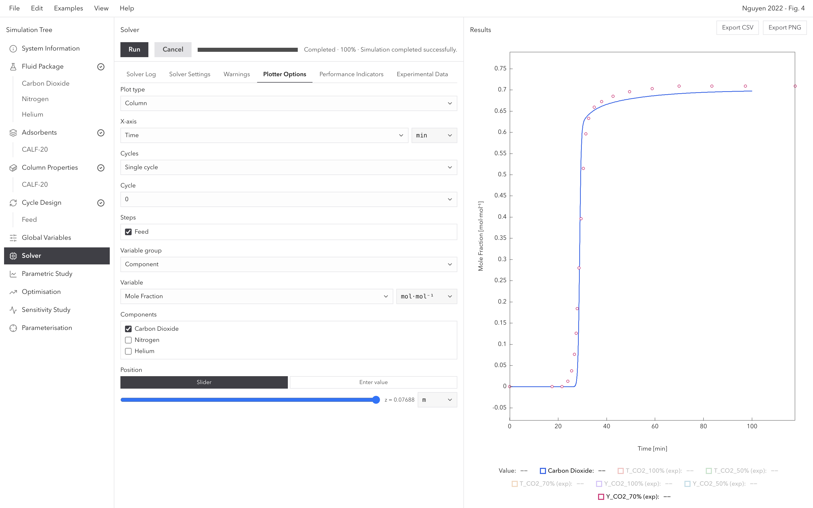
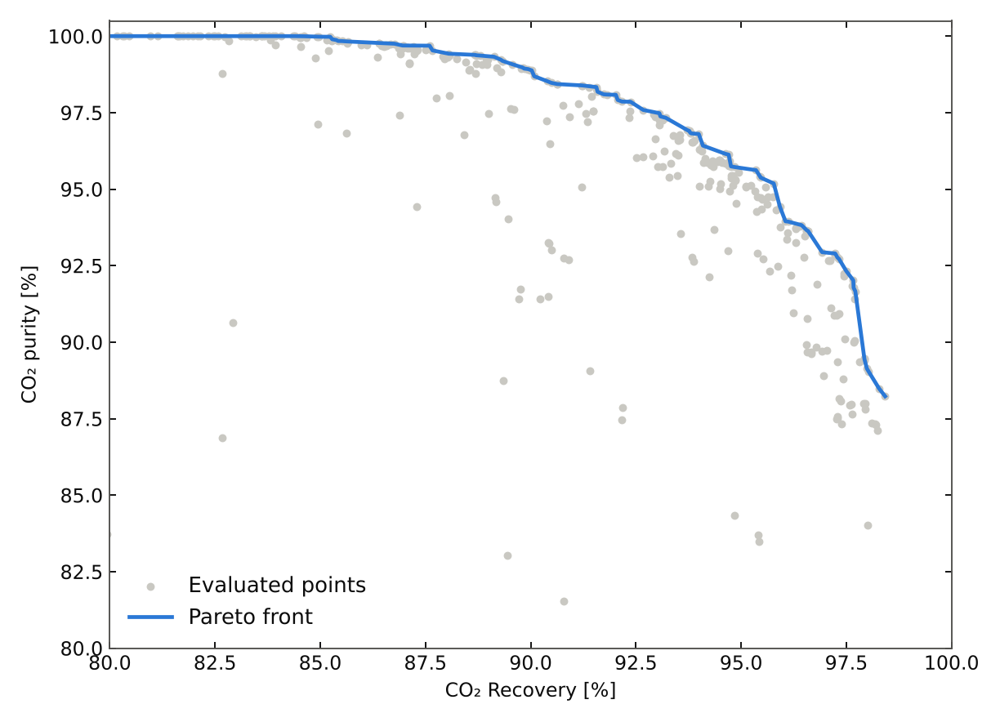

<p align="center">
  <picture>
    <source media="(prefers-color-scheme: dark)" srcset="docs/assets/logo-dark.png">
    
  </picture>
</p>

# Skarstrom

[](https://github.com/samaffleck/skarstrom/actions/workflows/ci.yml)
[](https://samaffleck.github.io/skarstrom/)
[](LICENSE)

**Skarstrom** is an open-source library for adsorption process simulations including **pressure, vacuum and temperature swing adsorption** (PSA, VSA and TSA). Written in C++, the engine solves a 1D finite-volume model of a packed-bed adsorption column with multiple layers. Skarstrom is designed for engineers and scientists to rapidly develop new adsorption-based gas separation systems, with modules for accelerating convergence to cyclic steady state and for optimising purity, recovery, productivity and energy consumption.

## Get started

Use the [web interface](https://www.skarstrom.co.uk/) to run the engine in your browser, with no install.

[](https://www.skarstrom.co.uk/)

Or point your agent (e.g. Claude or Codex) at this repository. An example prompt:

```text
Use Skarstrom (https://github.com/samaffleck/skarstrom) to design a 4-step
LPP cycle for CO2/N2 separation on zeolite 13X. Optimise the process
parameters to maximise purity and recovery.
```

[9/11/2025] Using Opus 5.5 High, the following Pareto front was generated:



[`AGENTS.md`](AGENTS.md) tells the agent how to install and run Skarstrom and how to check its results.

## Why Skarstrom

Several commercial simulation packages are available, but to date there has been no good open-source tool for adsorption modelling. It has become common practice for people to write their own models from scratch, resulting in a lot of repeated work and a lack of transparency and reproducibility.

Skarstrom aims to bridge this gap by being the first comprehensive open project for adsorption researchers to collaborate on. We also showcase exceptional solver speed and performance, and hope this can be improved further by collaboration with the community.

## Performance

Cycle optimisation and parameter fitting are important design tasks that require running to cyclic steady state (CSS) hundreds or thousands of times, so Skarstrom has been optimised for performance to make these tasks practical on common hardware. There are no well-established performance benchmarks; however, the table below can be used as a guide to the expected time to reach CSS. You are encouraged to run the examples yourself and benchmark them against your own code.

| Example | Cells | Cycles to CSS | Time to CSS |
|---|---|---|---|
| [Basic 4-step VSA, 15 % CO₂ / N₂ on zeolite 13X (`Perez2019_A`)](https://github.com/samaffleck/skarstrom/blob/main/examples/decks/Perez2019_A.json) | 30 | 50 | 4.4 s |
| [4-step VPSA with light-product pressurisation, CO₂ / N₂ on CALF-20 (`Nguyen2023_Exp_VI`)](https://github.com/samaffleck/skarstrom/blob/main/examples/decks/Nguyen2023_Exp_VI.json) | 100 | 68 | 16.5 s |
| [4-step PVSA for biogas upgrading, 40 % CO₂ / CH₄ on zeolite NaY (`Ferre2026_NaYF`)](https://github.com/samaffleck/skarstrom/blob/main/examples/decks/Ferre2026_NaYF.json) | 30 | 30 | 3.1 s |
| [4-step VSA, 15 % CO₂ / N₂ on Mg-MOF-74 (`Ward2024`)](https://github.com/samaffleck/skarstrom/blob/main/examples/decks/Ward2024.json) | 30 | 55 | 4.4 s |
| [4-step VSA, 15 % CO₂ / N₂ on Mg-MOF-74 (`Ward2024`), finer grid](https://github.com/samaffleck/skarstrom/blob/main/examples/decks/Ward2024.json) | 90 | 52 | 14.6 s |

*CSS is reached when every component's mass balance over a cycle closes within 0.5 %. Median of 3 runs on one core of an Apple M4, Release build; reproduce with `python scripts/benchmark_css.py`.*

## Documentation

The full documentation is at <https://samaffleck.github.io/skarstrom/>: getting started, the Python API and command line, tutorials, the model equations, the adsorbent library and the validation results.

## Citing

If you use Skarstrom in published work, please cite it using [`CITATION.cff`](CITATION.cff).

## Get involved

If you would like to be a part of the **steering committee** to guide Skarstrom's direction, please contact [Sam Affleck on LinkedIn](https://www.linkedin.com/in/sam-affleck). People from **academia and industry** are both welcome.

## Contributing

Contributions are welcome — see [CONTRIBUTING.md](CONTRIBUTING.md) (DCO sign-off, tests, data-integrity rules) and the [Code of Conduct](CODE_OF_CONDUCT.md). Security issues: [SECURITY.md](SECURITY.md). Coding agents: [AGENTS.md](AGENTS.md).

## Licence

Skarstrom is licensed under the [Apache License 2.0](LICENSE); see also [NOTICE](NOTICE). It builds on third-party components under their own permissive licences, listed in [THIRD_PARTY_NOTICES.md](THIRD_PARTY_NOTICES.md).
