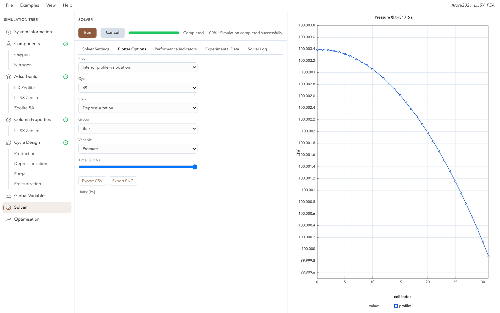

<p align="center">
  <picture>
    <source media="(prefers-color-scheme: dark)" srcset="docs/assets/logo-dark.png">
    
  </picture>
</p>

# Skarstrom

[](https://github.com/samaffleck/skarstrom/actions/workflows/ci.yml)
[](https://samaffleck.github.io/skarstrom/)
[](LICENSE)

**Skarstrom** is an open-source simulator for **pressure, vacuum and temperature swing adsorption** (PSA, VSA and TSA) processes. It solves a one-dimensional finite-volume model of a packed adsorption column — coupled mass, momentum and energy balances with non-linear multi-component isotherms and mass-transfer kinetics, a wall energy balance and real-gas properties from CoolProp — as a differential-algebraic system with SUNDIALS IDA. It assembles multi-step, multi-bed cycles (valves, pumps, pressure equalisation, light-product pressurisation, reflux), runs them to cyclic steady state with optional acceleration, and reports purity, recovery, productivity and energy.

- **Engine:** a C++20 library (`adsim`) with a CMake package (`find_package(Adsim)`), usable as a subproject and buildable with Emscripten.
- **Python:** the `skarstrom` package and command-line tool (pybind11), with NumPy results, a parameter registry, and the engine's isotherm fitter.
- **Data:** 33 example decks reproducing published studies, a curated and cited adsorbent library, and automated validation against the literature.

## Why Skarstrom

Adsorption processes such as PSA, VSA and TSA are central to gas separation, carbon capture and gas purification, but there has been no good open-source tool for simulating them. Researchers and engineers write their own column models from scratch, or work in closed commercial packages. That costs time, and it makes results hard to compare: two groups modelling the same cycle rarely share an implementation, a set of parameters or a way to check one another's numbers.

Skarstrom aims to be the shared, open, tested foundation. A standard engine, deck format and cited adsorbent library let the community reproduce published work, compare like with like, and build on each other's models instead of starting again.

## Browser interface

[](https://www.skarstrom.co.uk/)

The [Skarstrom website](https://www.skarstrom.co.uk/) is a browser-based user interface that runs this engine. You can create simulations or import them as JSON deck files, visualise the results, and run optimisation and parameterisation studies.

## Install

Once published on PyPI (Linux, macOS 13.3+ and Windows wheels for Python 3.10–3.13):

```bash
pip install skarstrom
```

From source now (Python 3.9+, CMake 3.15+, a C++20 compiler; Ninja recommended):

```bash
git clone --recursive https://github.com/samaffleck/skarstrom.git
cd skarstrom
pip install .              # builds the engine (several minutes the first time)
```

## Quick start

```python
import skarstrom

sim = skarstrom.examples.Perez2019_A.load()   # 33 bundled decks; or skarstrom.Simulation("deck.json")
sim.steps["Feed"].time = "2 min"          # units are explicit; a bare number is SI
sim.steps["Feed"].bottom.y["CO2"] = 0.15  # the feed stream's CO2 mole fraction
result = sim.run()                        # to cyclic steady state
print(result.status, result.css_cycle)

for k in sim.kpis(cycle=-1):
    print(k.component, f"purity {k.purity:.3f}", f"recovery {k.recovery:.3f}")

y = sim.series("mole_fraction", "CarbonDioxide", location="top")   # NumPy: y.time, y.values
fit = skarstrom.fit_isotherm("sips", p_pa, q_molkg, temperature=298.15)
```

## Command line

```bash
skarstrom examples                                     # list the bundled decks
skarstrom examples run "Ward2022_Q100ccm" --json   # run one; JSON summary on stdout
skarstrom run deck.json --cycles 20 --set "step[Feed].time=120" --csv out/
skarstrom params deck.json [--all] [--json]            # settable parameters and their paths
```

## Documentation

<https://samaffleck.github.io/skarstrom/> — getting started, the Python API and CLI, tutorials, the model equations, numerics, the adsorbent library and the validation results. The sources are in [`docs/`](docs/); `examples/` has a runnable script for every deck family.

Build the C++ library and tests with the CMake presets:

```bash
cmake --preset linux-release        # or macos-release / windows
cmake --build --preset linux-release
ctest --preset linux-release -j3    # ~670 tests; writes ~4 GB to adsim/Results (delete afterwards)
```

## Validation

Every bundled paper deck is an automated test that computes an explicit error metric against numbers transcribed from the paper or curves digitised from its figures. The [validation page](https://samaffleck.github.io/skarstrom/validation/) is generated from those tests (48 cases from 10 publications; 194 asserted comparisons):

| Publication | Against | Median error | Worst error |
|---|---|---|---|
| Arora & Hasan (2021), O₂ PSA | paper model | 4.09 pp | 45.6 pp |
| Casas et al. (2012), CO₂/H₂ breakthrough | paper model, isotherm fit | 3.68 % (rel.) | 18.8 % (rel.) |
| Ferré et al. (2026), biogas PVSA | paper model | 1.11 pp / 7.37 % | 10.7 pp / 58.6 % |
| Nguyen et al. (2022), CALF-20 breakthrough | experiment | 9.94 % NRMSE | 12.4 % NRMSE |
| Nguyen et al. (2023), CALF-20 VPSA | experiment, paper model | 2.07 pp | 9.76 pp |
| Estupiñan Perez et al. (2019), 13X VSA | experiment, paper model | 4.28 pp | 11.1 pp |
| Streb & Mazzotti (2021), 13X breakthrough | experiment | 36.1 % NRMSE, 16.5 K | 82.9 % NRMSE, 32.6 K |
| Vysyaraju et al. (2024), He/N₂ PSA | experiment, paper model | 1.91 pp | 14 pp |
| Ward & Pini (2022), activated carbon breakthrough | experiment | 37.9 % NRMSE, 3.54 K | 38.2 % NRMSE, 4.21 K |
| Ward & Pini (2024), Mg-MOF-74 VSA | paper model | 1.79 pp | 2.3 pp |

Caveats: the tolerances are **regression bounds** set from the current model's measured error, not acceptance criteria, so a passing test can still be a large, documented disagreement (Arora 2021 net recovery, Streb 2021 curves). Many comparisons are against the authors' **own models** rather than measurements. Every deck is a prediction with the paper's published parameters — nothing is refitted per experiment — and the sampling lines between column and detector are not modelled. Each paper folder in `adsim/test/papers/` documents its inputs and the known causes of disagreement.

## Citing

If you use Skarstrom in published work, please cite it using [`CITATION.cff`](CITATION.cff) (GitHub shows a "Cite this repository" button), and cite the original sources of any adsorbent data or validation case you rely on.

## Get involved

We are forming a **steering committee** to guide Skarstrom's direction: which models and features come next, how validation cases and adsorbent data are curated, and how the project is governed as it grows. People from **academia and industry** are both welcome. If you would like to join, contact [Sam Affleck on LinkedIn](https://www.linkedin.com/in/sam-affleck).

## Contributing

Contributions are welcome — see [CONTRIBUTING.md](CONTRIBUTING.md) (DCO sign-off, tests, data-integrity rules) and the [Code of Conduct](CODE_OF_CONDUCT.md). Security issues: [SECURITY.md](SECURITY.md). Coding agents: [AGENTS.md](AGENTS.md).

## Licence

Skarstrom is licensed under the [Apache License 2.0](LICENSE); see also [NOTICE](NOTICE). It builds on third-party components under their own permissive licences, listed in [THIRD_PARTY_NOTICES.md](THIRD_PARTY_NOTICES.md).
